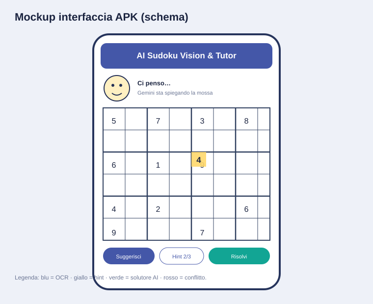
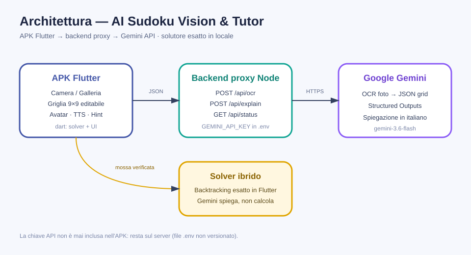

# Relazione tecnica — AI Sudoku Vision & Tutor

**Consegna:** Google Classroom · **Modalità:** individuale/gruppo max 3 · **SDK:** Flutter + Android SDK · **API:** Google Gemini

## 1. Obiettivo

Realizzare un'applicazione Android installabile (APK) che acquisisca una foto di un Sudoku cartaceo incompleto, ne estragga la matrice 9×9 tramite Gemini e fornisca supporto guidato: correzione manuale, suggerimento della mossa più semplice con spiegazione logica, hint progressivi e risoluzione completa.



*Figura 1 — Schema dell'interfaccia: acquisizione, griglia editabile, tutor e controlli.*

## 2. Architettura scelta

L'app è un client Flutter che parla con una **Supabase Edge Function** (`gemini-proxy`): è l'unico componente a conoscere la chiave API, custodita nei Supabase Secrets (`GEMINI_API_KEY`, mai nell'APK e mai distribuita in `.env`). Lo stesso progetto Supabase fornisce account e sincronizzazione. Il flusso è:

1. **Acquisizione**: `image_picker` apre fotocamera o galleria; l'immagine viene codificata in base64.
2. **OCR**: `POST /api/ocr` invia immagine e prompt a Gemini con *Structured Outputs* (`responseMimeType: application/json` + `responseSchema`). La Edge Function valida che la risposta sia una matrice 9×9 di interi 0–9. Se funzione/rete/chiave non sono disponibili, il client esegue un OCR locale con Tesseract: rileva le 10 linee della griglia, ritaglia le sole celle con inchiostro, ricostruisce ogni cifra su sfondo bianco e valida la matrice con il solutore. Il modello `eng.traineddata` (3,9 MB) è incluso negli asset dell'APK.
3. **Verifica**: la griglia viene renderizzata in 81 `TextField`; le celle riconosciute sono blu e l'utente può correggerle. I conflitti (duplicati su riga/colonna/blocco) diventano rossi.
4. **Tutor**: `POST /api/explain` chiede a Gemini una spiegazione in italiano; se API o rete mancano, il client genera comunque una spiegazione regola-based.
5. **Risoluzione**: un backtracking esatto in Dart (e lo speculare modulo TypeScript nella Edge Function) completa la griglia e colora di verde le celle aggiunte dall'AI.
6. **Sync (opzionale)**: Supabase Auth con magic link (deep link `it.sudokuvision.app://login-callback`, flusso PKCE) o email/password; un'unica tabella `player_progress` con RLS memorizza progressi e impostamenti JSON per utente. La chiave anon è pubblica, quella `service_role` non è mai inclusa.



*Figura 2 — Architettura a tre livelli e solver ibrido.*

## 3. Integrazione API e gestione JSON

Il modello predefinito è `gemini-3.6-flash`, con fallback automatico a `gemini-3.5-flash-lite` e `gemini-3.8-flash` in caso di picchi di richieste o disattivazione (configurabile via `GEMINI_MODEL`). Lo schema OCR richiede:

```json
{ "valid": boolean, "grid": number[9][9], "note": string }
```

Lo schema della spiegazione richiede:

```json
{ "row": 0-8, "col": 0-8, "valore": 1-9, "spiegazione": "testo italiano" }
```

La Edge Function rimuove eventuali fence Markdown, effettua il `JSON.parse`, verifica forma e valori e restituisce errori HTTP significativi (400 input non valido, 422 griglia inconsistente, 503 chiave mancante, 502 errore Gemini). L'app mostra ogni errore in snackbar e nello stato del tutor.

## 4. Funzionalità bonus implementate

| Bonus | Implementazione |
|---|---|
| OCR offline | Tesseract4Android con modello `eng` incluso; rilettura delle celle con soglia di Otsu locale, validazione con solver; usato in automatico se Gemini fallisce o su richiesta esplicita |
| Solutore ibrido | Backtracking con MRV in Dart/TypeScript; Gemini usato solo per spiegare, mai per calcolo numerico |
| Hint progressivi | 3 livelli: blocco 3x3 → cella e vincoli → numero con spiegazione |
| Tutor vocale | `flutter_tts`, lingua `it-IT`, attivabile dall'appbar o dal pulsante "Leggi" |
| Mascotte pinguino | Pinguino disegnato via `CustomPainter` (corpo, ali, sciarpa, becco) con stati idle, thinking, happy, error; ricorre nel tutor, nei livelli e nelle lezioni. Le 4 icone della barra inferiore sono scene dedicate: pinguino con fotocamera (Foto), pinguino davanti a un sudoku (Livelli), pinguino con occhiali e libro "SUDOKU" (Impara), pinguino con scatola "DATI" (Profilo) |
| Interfaccia Duolingo-style | Tema condiviso (`duo_theme.dart`): palette verde/blu/giallo, pulsanti con ombra inferiore "3D", card arrotondate, griglia a celle arrotondate, **linee nere spesse tra i blocchi 3x3** e cornice esterna, percorso livelli con pinguini |
| Overlay AR lite | Canvas che sovrappone i numeri mancanti alla foto acquisita |
| Modalità Livelli | 8 puzzle con difficoltà crescente, generati con soluzione unica garantita; stelle, XP, tempi migliori e sblocchi progressivi salvati in locale. Gameplay: 3 cuori con errore immediato (numero errato rimosso e lampo rosso), evidenziazione blu di tutte le occorrenze del numero toccato, massimo 3 suggerimenti con contatore `Suggerimenti 3/3`, cascade animata "domino" delle righe/colonne/blocchi completati. **Nessuno snackbar durante il gioco**: il riscontro visivo avviene solo tramite cuori, colori e contatore. Lo stesso motore (`SudokuGameScreen`) è riutilizzato dalla pagina Foto per giocare la griglia digitalizzata (soluzione calcolata in locale, senza XP né sblocchi) |
| Lezioni guidate | 6 passaggi interattivi (riga, colonna, blocco, 3 esercizi) per imparare le regole da zero, senza backend |
| Account e cloud sync | Supabase Auth: magic link con deep link PKCE oppure email/password; stelle, tempi, lezioni, URL della funzione Gemini e voce uniti per il miglior risultato, protetti da Row Level Security. La UI di **Profilo** contiene solo il login: URL/chiave sono iniettati a build time con `--dart-define` e nessuna schermata di configurazione è esposta all'utente |

## 5. Test e risultati

- `npm run test:server` verifica solver, rilevamento conflitti, conteggio soluzioni e conversioni.
- `flutter test` verifica la logica Dart su puzzle noto, mosse logiche, casi non risolvibili, unicità degli 8 livelli, merge dei progressi cloud, refresh automatico degli XP dopo il sync, parsing/rilevamento griglia e soglia adattiva dell'OCR locale, griglie vuote, navigazione tra le 4 schede, assenza di UI di configurazione in Profilo, etichette dei pulsanti, blocca numeri dati/barra numeri dei Livelli, evidenziazione occorrenze, 3 cuori con rimozione del numero errato e assenza di snackbar, limite di 3 suggerimenti con contatore, cascata animata delle righe/colonne/blocchi completati, giocabilità della griglia digitalizzata dalla foto con lo stesso motore dei Livelli e invio dell'header `apikey` alla Edge Function (24 test totali).
- `flutter build apk --release` produce `AI-Sudoku-Vision-Tutor.apk` (~75,9 MB, include modello Tesseract e librerie native per arm64-v8a/armeabi-v7a/x86_64), installabile su Android 8+ (minSdk 24). Configurazione Supabase iniettata con `--dart-define` (URL e publishable key verificati dentro `libapp.so`; la chiave Gemini resta solo nei Secrets).

Gli screenshot reali dell'app sono inclusi nella cartella `screenshots/`:

| File | Schermata |
|---|---|
| `screenshots/ai_solution.jpeg` | griglia con soluzione/risultato dell'AI |
| `screenshots/livelli.jpeg` | percorso dei livelli |
| `screenshots/impara.jpeg` | lezioni guidate |
| `screenshots/profilo.jpeg` | accesso e profilo Supabase |

Le immagini sono screenshot da dispositivo Android, risoluzione 720×1444 / 720×1570 px.

## 6. Consegna

- [x] Codice sorgente completo (Flutter + Supabase Edge Function)
- [x] `.env.example` senza chiave reale
- [x] APK release `AI-Sudoku-Vision-Tutor.apk` nella cartella radice
- [x] Relazione tecnica (questo file)
- [x] Screenshot reali in `screenshots/` (`ai_solution.jpeg`, `livelli.jpeg`, `impara.jpeg`, `profilo.jpeg`)
